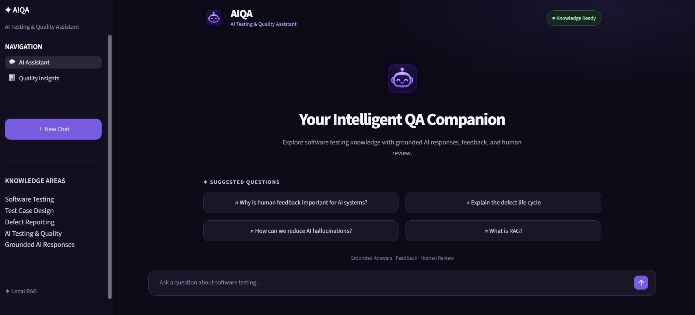
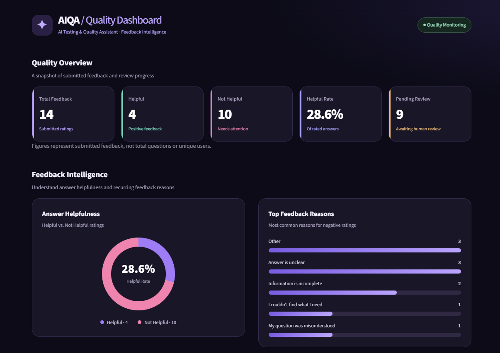
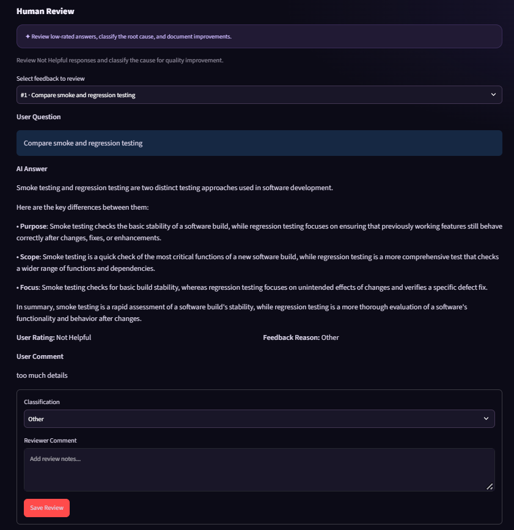

AIQA — AI Testing & Quality Assistant
A personal proof-of-concept exploring how retrieval-augmented generation (RAG), user feedback, and human review can support software testing knowledge and AI response quality.
Project showcase: This public repository documents the project and its demonstration. The application source code is not included.

Overview
AIQA is a local AI assistant designed to answer questions about software testing using a curated knowledge base. Beyond question answering, the prototype includes feedback collection, quality insights, and a human review workflow to help assess and improve AI-generated responses.
Key Features
- Knowledge-grounded Q&A: Uses retrieval-augmented generation to respond based on a local software testing knowledge base.
- Feedback collection: Users can rate answers as helpful or not helpful and provide reasons or comments.
- Quality Insights dashboard: Summarizes feedback and supports visibility into response quality.
- Human-in-the-loop review: Enables review and classification of feedback requiring attention.
- Local-first prototype: Runs with a local language model and vector database.
Technology Stack
Area	Technology
Application interface	Python, Streamlit
RAG orchestration	LangChain
Local model runtime	Ollama
Language model	Llama 3.2
Embeddings	nomic-embed-text
Vector database	Chroma
Feedback tracking	CSV-based prototype storage

Demonstration
Watch AIQA in action — from knowledge-grounded question answering to feedback collection, quality insights, and human review.

🎬 [https://github.com/Mahazd/AIQA-AI-Testing-Quality-Assistant/releases/download/v1.0/AIQA.mp4]

## Project Screenshots

### AI Assistant

### Quality Insights

### Human Review

Quality Engineering Focus
This project explores more than generating answers. Its quality-focused design includes:
1. Grounding responses in an available knowledge base.
2. Capturing explicit user feedback about answer usefulness.
3. Making feedback trends visible through a dashboard.
4. Supporting human assessment of responses that need review.
Prototype scope: The current dashboard and review process support manual quality assessment; they should not be interpreted as an independently validated measure of model accuracy or a production-ready evaluation framework.
Future Improvements
- Build a structured evaluation dataset with expected answers.
- Add retrieval and response-quality evaluation metrics.
- Improve feedback analysis and reporting.
- Expand knowledge coverage and regression testing.
- Evaluate deployment, security, and data-governance requirements before any organizational use.
Project Status
Personal proof of concept — ongoing development. The demonstration uses general software testing content and is not intended to expose organizational systems or confidential data.
Author & Portfolio Use
Created as a personal project to explore the intersection of software quality engineering, generative AI, and human-centered AI evaluation.
This repository is a project showcase; implementation files are intentionally kept private.
